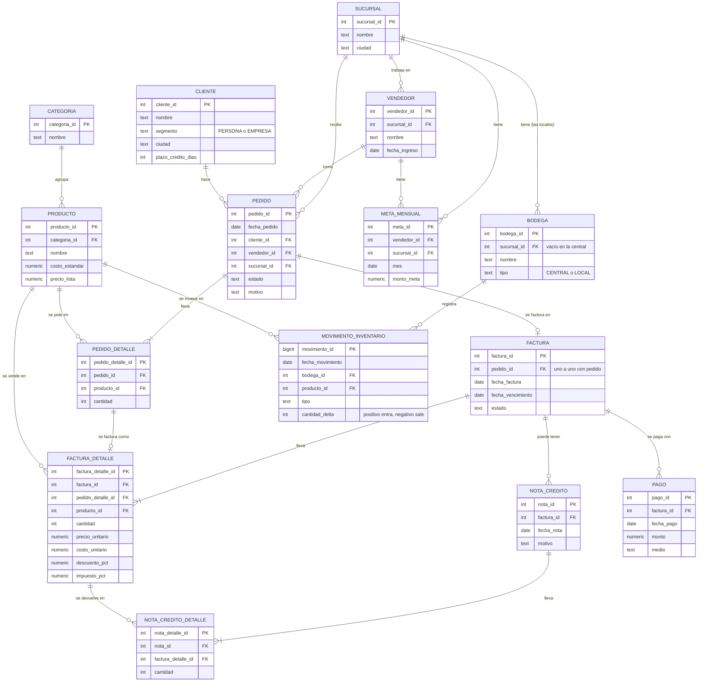

# Diagrama entidad-relación (OLTP)

Así está organizada la base de la operación diaria de la tienda: 15 tablas.
La imagen `diagrama_er.png` es el mismo diagrama.

## Cómo leerlo

- Un **pedido** es lo que el cliente pide. Si se aprueba, se convierte en **una factura**.
- La **factura** tiene varias líneas (productos). Si el cliente devuelve algo, se hace una
  **nota crédito** que apunta a la línea devuelta. La factura original no se borra.
- Los **pagos** van contra la factura y pueden ser parciales.
- El **inventario** no se guarda como un número fijo: se calcula sumando todos los movimientos
  (entradas en positivo, salidas en negativo) de cada producto en cada bodega.
- Las **metas** son por vendedor, sucursal y mes.

Comparado con la infografía del curso, agregamos las tablas `sucursal`, `nota_credito` y
`nota_credito_detalle`, que están en los datos reales pero no salen en la imagen.
