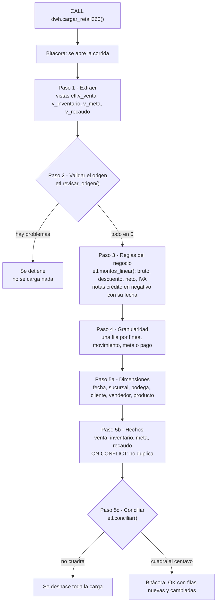

# Flujo del ETL

Así viajan los datos desde la operación hasta el modelo de análisis cuando se corre
`CALL dwh.cargar_retail360();`. La imagen `flujo_etl.png` es el mismo diagrama.

## En palabras

1. **Extraer.** Unas vistas leen la operación tal cual. No copian nada, solo juntan las tablas
   que se necesitan (por ejemplo, la línea de factura con su factura y su pedido).
2. **Validar.** Antes de tocar el modelo se revisan 7 cosas que la base de la operación no
   impide sola, como un pago con fecha anterior a la factura. Si aparece una, la carga no arranca.
3. **Reglas del negocio.** Una sola función calcula los valores de cada línea, así las ventas
   y las devoluciones usan exactamente el mismo redondeo. Las devoluciones entran en negativo.
4. **Granularidad.** Cada hecho tiene su propio nivel de detalle y su propia fecha. Nada se
   mezcla: la meta no se pega a las ventas y el inventario no se convierte en ventas.
5. **Cargar y revisar.** Primero las dimensiones y después los hechos. Al final se compara
   el modelo con la operación (filas y pesos). Si algo no cuadra, se deshace todo.
