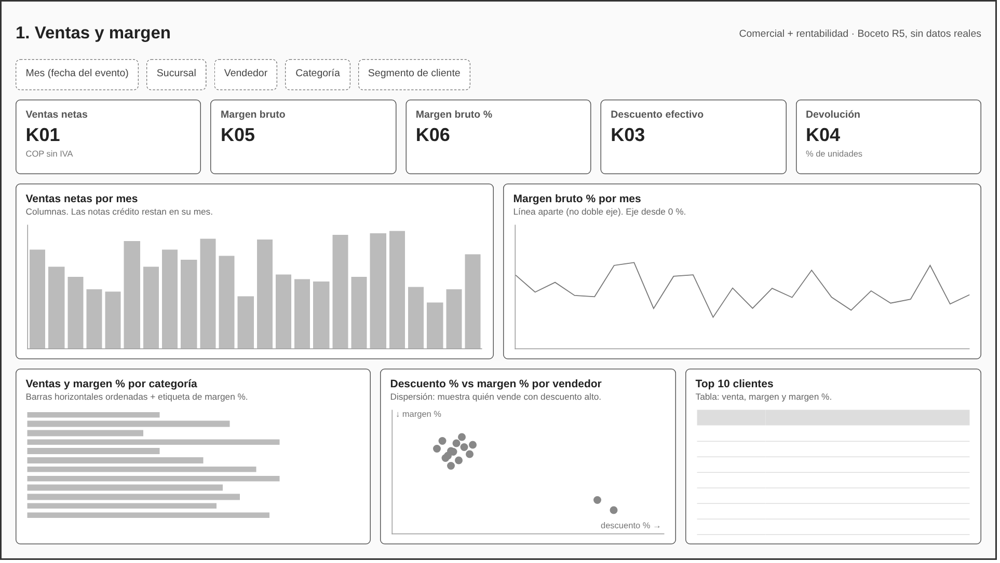
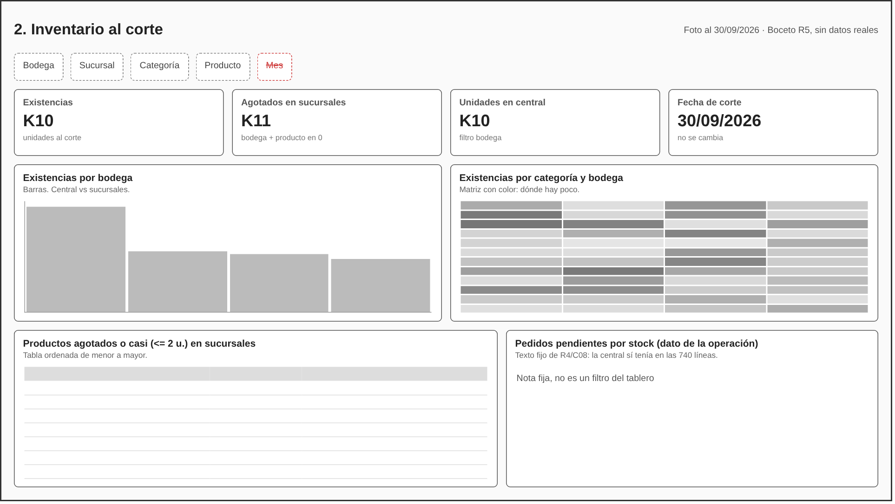
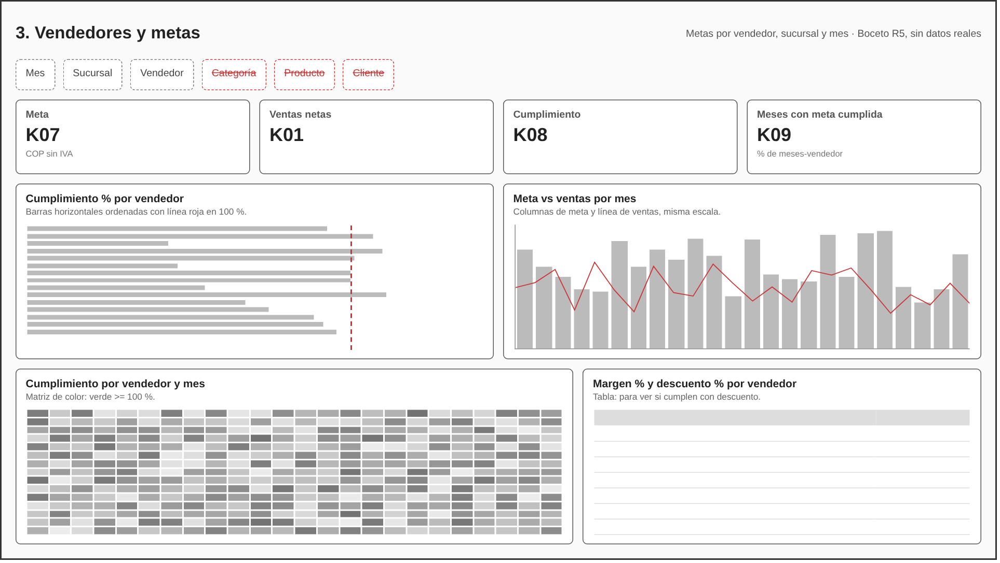
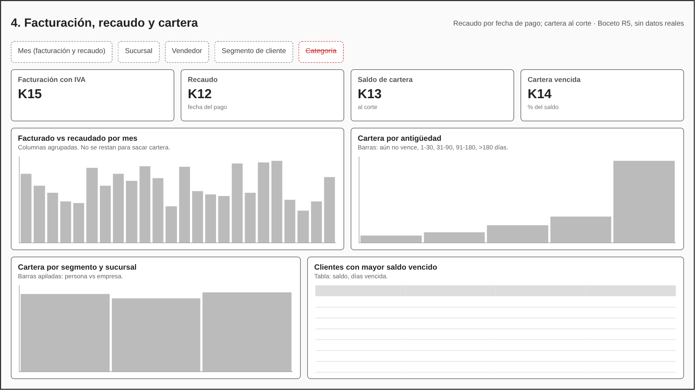

# Bocetos de los 4 tableros

Antes de abrir Power BI dibujamos cómo se va a ver cada página. Son bocetos: las barras y
los números son de mentira, solo muestran dónde va cada cosa. Las imágenes están en la carpeta
`wireframes/`. Cada tarjeta dice qué indicador del catálogo muestra (K01, K05...).

Los filtros tachados en rojo son los que esa página **no** debe tener, porque el dato no lo
permite.

## 1. Ventas y margen

- **Tarjetas:** K01, K05, K06, K03, K04.
- **Ventas por mes (columnas):** para comparar meses, las columnas se leen mejor que una línea.
- **Margen % por mes (línea aparte):** no usamos doble eje con las ventas, porque con dos
  escalas se puede hacer que parezca que una sube cuando la otra baja.
- **Ventas y margen por categoría (barras horizontales ordenadas):** los nombres se leen
  completos y el orden muestra de una cuál vende más. Aquí debería resaltar Redes, con margen
  bajo (reto C09).
- **Descuento vs margen por vendedor (dispersión):** los dos vendedores con descuento alto
  quedan solos en una esquina (reto C07).

## 2. Inventario al corte

- **Tarjetas:** K10, K11, existencias de la central y la fecha de corte a la vista.
- **Sin filtro de mes:** el inventario es una foto al 30/09/2026. Un filtro de mes invitaría a
  sumar fotos de varias fechas.
- **Matriz categoría por bodega con color:** muestra rápido dónde hay poco.
- **Tabla de agotados o casi agotados:** es lo que alguien de compras o logística tiene que ver.
- **Nota de pedidos pendientes:** los pedidos no están en el modelo de análisis; se deja como
  texto el resultado del reto C08 (la central sí tenía).

## 3. Vendedores y metas

- **Tarjetas:** K07, K01, K08, K09.
- **Sin filtro de categoría, producto ni cliente:** la meta no tiene esos datos (reto C12).
- **Cumplimiento por vendedor (barras ordenadas con línea en 100 %):** se ve de un vistazo
  quién está por encima y quién por debajo.
- **Meta contra ventas por mes:** las dos en la misma escala y eje desde 0.
- **Matriz vendedor por mes:** el K08 total puede tapar meses malos; la matriz los muestra.
- **Tabla de margen y descuento por vendedor:** para no premiar a quien cumple regalando margen.

## 4. Facturación, recaudo y cartera

- **Tarjetas:** K15, K12, K13, K14. Todas con IVA, para comparar peras con peras.
- **Facturado contra recaudado por mes (columnas agrupadas):** muestra el flujo de cada mes.
  Debajo va la advertencia de que restarlos no da la cartera (reto C10).
- **Cartera por antigüedad (barras):** el saldo de más de 180 días es la parte más grande.
- **Cartera por segmento:** separa personas (contado) de empresas (30 días).
- **Sin filtro de categoría:** la cartera se calcula por factura, y una factura puede tener
  productos de varias categorías.

## Gráficas que NO vamos a usar

| Gráfica | Por qué engaña |
|---|---|
| Torta con las 12 categorías | Con tantas tajadas parecidas no se distingue cuál es más grande |
| Doble eje ventas y margen % | Moviendo las escalas se puede inventar una relación que no existe |
| Barras con el eje que no empieza en 0 | Diferencias pequeñas parecen enormes |
| Meta por categoría | La meta no tiene categoría: sale multiplicada (C12) |
| Inventario "total" sumando meses | Cuenta las mismas unidades varias veces |
| Promedio de porcentajes de margen | Una venta pequeña pesa igual que una grande |
| Cartera = facturado del mes - recaudado del mes | No dice qué está vencido ni hace cuánto (C10) |

## Revisión de que todo compara al mismo nivel

- Metas y ventas se comparan solo por vendedor, sucursal y mes (páginas 3 y catálogo K08).
- El inventario es foto al corte, sin filtro de mes (página 2).
- Recaudo y cartera van con IVA y se comparan con K15, no con K01 (página 4).
